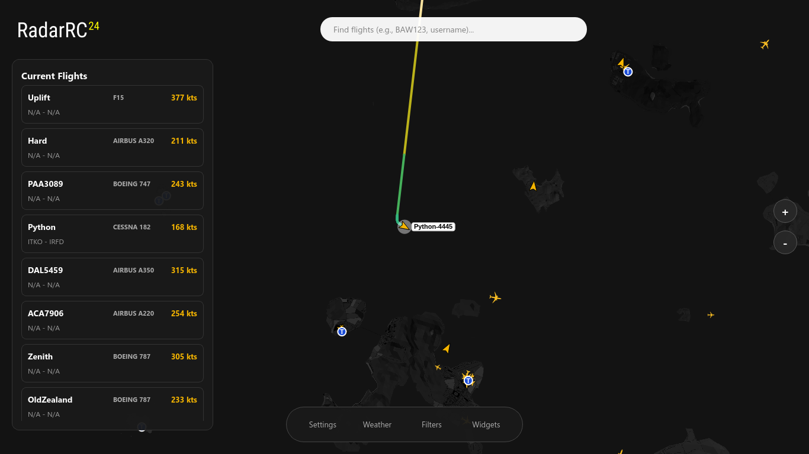

# RadarRC - ATC24 Flight Tracker

RadarRC is a modern desktop Flight Tracker application for PTFS (Pilot Training Flight Simulator) / ATC24. Built with Python and PySide6, it features a smooth, dark-themed user interface heavily inspired by Flightradar24.



## Features

*   **Real-time Data**: Connects directly to the 24Data API via WebSocket for live aircraft positions, altitudes, and speeds.
*   **Calibrated Custom Map**: Utilizes a high-resolution PNG map accurately aligned with in-game coordinates.
*   **Detailed Aircraft Icons**: Uses FlightRadar24 SVG assets that scale smoothly without pixelation.
*   **Rainbow Trail (Unfinished)**: Aircraft trails with altitude-based color gradients (White to Red) and Chaikin smoothing for seamless, rounded curves.
*   **SQLite Database**: Persists Flight Plan and Trail data across sessions. Data remains intact even if the application is closed.
*   **Auto-Follow Camera**: Clicking an aircraft smoothly zooms and pans the camera to follow its movement.
*   **Info Panel & Airline Logos**: Displays flight routes, telemetry, a copyable pilot username, and official airline logos.
*   **Search & Filters**: Locate flights by Callsign, ICAO, or Pilot Name, and filter out aircraft on the ground or helicopters.

## Prerequisites

*   Python 3.10 or newer.
*   OS: Linux (recommended), Windows, or macOS.

## Manual Installation

1.  **Clone the repository:**
    ```bash
    git clone https://github.com/ernugraha/RadarRC.git
    cd RadarRC
    ```
    
2.  **Create a Virtual Environment (Recommended):**
    ```bash
    python3 -m venv venv
    source venv/bin/activate  # On Linux/macOS
    # venv\Scripts\activate   # On Windows
    ```
    
3.  **Install dependencies:**
    ```bash
    pip install -r requirements.txt
    ```
    
4. **Run:**
    ```bash
    python3 run.py
    ```

